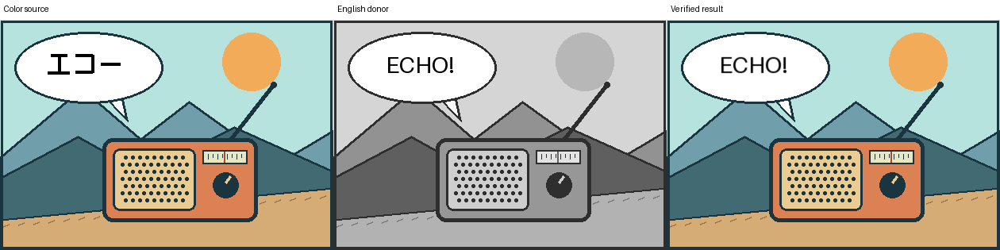

# Manga Lettering Localizer

Transfer English lettering from a black-and-white edition onto the matching color page. The color page supplies the artwork and canvas. The English page supplies the letter shapes, punctuation and emphasis.

This is a Windows-first Python command-line prototype. It runs locally on the CPU. The operator reviews page matches and edit regions. The renderer saves lossless PNGs and checks that every pixel outside the approved regions stayed identical to the decoded color original.



*The demo generates both editions of this original illustration. The English letters in the third panel come from the middle panel.*

## Try it on Windows

Use 64-bit Python 3.12. From the repository directory in PowerShell, run:

```powershell
py -3.12 -m venv .venv
.\.venv\Scripts\python.exe -m pip install -r requirements.txt
.\.venv\Scripts\python.exe demo.py
```

Open `demo-output/comparison.png` for the three-way comparison. The native master is `demo-output/output/pilot/001-radio.png`. The demo creates two miniature CBZs, inventories them, estimates page registration, transfers one balloon, then reopens the saved PNG and checks the source hashes. The final console line reports the number of changed pixels outside the approved regions. The expected value is zero.

Run the synthetic regression suite with:

```powershell
.\.venv\Scripts\python.exe -m pytest -q
```

## Use your own editions

Start with one known matching pair. Inventory your local archives, inspect the registration, then mark the source and destination lettering regions. Use files you have permission to process. Source archives, generated pages and extracted lettering stay in the local workspace. [One-page walkthrough](docs/one-page-study.md)

## What works today

| Stage | Current behavior |
| --- | --- |
| Import and matching | Read-only inventory with hashes, image metadata and gap or duplicate reports. Feature matching proposes page identities and donor-to-color transforms. |
| Lettering transfer | Flat balloons, reviewed captions and selected outlined effects. Separate masks authorize removing original ink and adding donor ink. Exposed artwork under an effect may require a locally sampled repair and visual review. |
| Verification | Reopen PNGs, check native dimensions and ICC metadata, compare protected pixels, and write per-page results. An offline index check verifies saved master hashes, comparison links and split-spread reading order. |
| Chapter studies | A resumable chapter runner and reviewed lettering selections support a configured study. New editions need their own page mapping and annotations. |

Development has reached a 40-canvas trial chapter with 225 transferred groups, including both sides of a spread. Five pilot scenes passed human review. The chapter still has effects and placement decisions under review. Volume-wide processing, a desktop review interface and verified CBZ export remain roadmap items.

## Where to look in the code

- Source inspection and geometric matching live in [inventory.py](manga_localizer/inventory.py) and [registration.py](manga_localizer/registration.py).
- Balloon masks, paper repair and over-art lettering live in [lettering.py](manga_localizer/lettering.py), [paper.py](manga_localizer/paper.py) and [effects.py](manga_localizer/effects.py).
- The [renderer](manga_localizer/render.py) writes masters and visual diagnostics. The [verifier](manga_localizer/verify.py) compares the saved result with the original archive.
- The [example study](examples/regions.json) shows the coordinates used by the demo. The [tests](tests/) build their fixtures locally.
